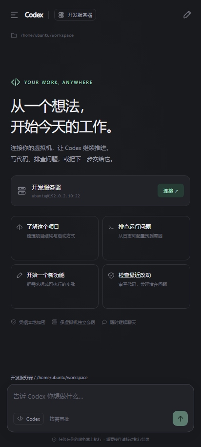
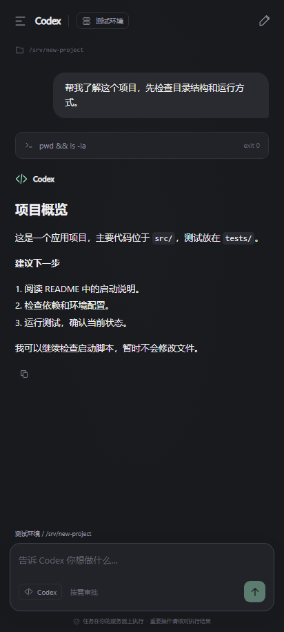
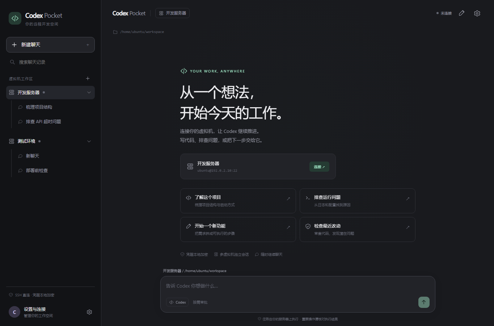

# Codex Pocket

[](https://github.com/Tombears/codex-pocket/actions/workflows/android.yml)
[](https://github.com/Tombears/codex-pocket/releases)
[](LICENSE)

面向安卓的独立 Codex SSH 客户端。手机通过 SSH 启动 Linux 服务器上的 `codex app-server`，以聊天形式发送任务、接收流式消息和处理审批。非 OpenAI 官方应用。

## 界面预览

以下为使用测试数据生成的界面预览；实际 APK 初次启动为空工作区。

<p>
  
  
</p>



## 功能

- 每台虚拟机/云服务器作为一级工作区，分别保存所属会话。
- SSH 密码认证、OpenSSH/PEM 私钥认证及私钥口令。
- 首次连接显示 SHA-256 主机指纹；固定密钥后，变化会阻止连接。
- 新建聊天时选择虚拟机和 Linux 绝对工作目录。
- 聊天记录搜索、重命名、删除本地记录。
- 按服务器导入 Codex 远程会话，按需读取远程历史，继续原 thread。
- 流式回答、代码块、命令执行输出、文件改动、执行审批和问题回答。
- 命令卡片单行显示摘要，长命令省略；展开后查看完整命令和输出。
- 接收服务器生成或引用的图片，支持缩略图、查看原图、保存原图和加载失败重试。
- 输入框旁选择审批模式：按需审批、严格审批、不询问；按聊天保存，新聊天沿用最近选择。
- 停止当前任务、断开单台或全部服务器连接。
- 深色默认，可切换浅色；手机抽屉侧栏，大屏双栏布局。
- Android 前台服务维持连接并提示待审批事项。
- 自动识别远程用户主目录与 Codex 安装路径；路径覆盖为可选高级设置。
- SSH 到 Codex 握手的连接总超时为 30 秒，显示当前阶段，可取消；错误保留在连接设置中。
- 编辑连接时可直接测试当前表单里的 SSH、路径识别与 Codex 握手；测试不保存修改、不打断已有连接，指纹确认后会返回原表单。
- GFM Markdown：标题、嵌套列表、表格、引用、链接、行内代码、代码高亮和代码复制；支持流式文本和历史回答。远程 HTML 作为文字显示，外部 HTTP 图片不会自动下载；服务器文件图片通过已有 SSH 连接接收。
- 前台服务与连接保活、网络变化感知、自动重连、服务重启后恢复已保存的连接意图；主动断开后停止重连。中断任务不会自动重发。
- 设置中可导出最近 24 小时的调试日志，记录连接阶段和错误，不记录私钥、密码或聊天正文。
- 密码、私钥和聊天记录统一使用 Android Keystore 生成的 AES-GCM 密钥加密保存；不进入网页初始化数据。关闭系统备份。

## 安装与使用

支持 Android 8.0（API 26）及以上，需要较新的 Android System WebView。请前往 [**Releases**](https://github.com/Tombears/codex-pocket/releases) 下载 APK；0.4.1 为正式发布版，沿用固定签名，新增原图查看和保存，支持服务器图片接收、单行命令卡片和可选审批模式，并保留设置内测试连接、Markdown、后台保活、自动重连、30 秒连接总超时和日志导出，同页提供 `SHA256SUMS.txt` 校验文件。

也可以自行构建，或在 [GitHub Actions](https://github.com/Tombears/codex-pocket/actions/workflows/android.yml) 成功构建页面的 Artifacts 下载 `codex-pocket-release`（固定签名包）。下载 Actions 构建产物可能需要登录 GitHub。

从 **0.1.2** 起，Releases 的正式安装包使用固定签名，应用包名与本地加密存储标识保持一致。后续版本使用更高 versionCode，可直接覆盖安装，保留连接配置、保存的凭据和聊天记录。

旧版 0.1.0 / 0.1.1 使用已丢失私钥的临时 debug 签名，无法直接覆盖迁移到固定签名版。这次需要卸载并重新配置，卸载会清空手机本地数据；服务器上的 Codex 会话和文件不受影响。之后请使用同一仓库 Releases 中的固定签名版本更新，不要混用自行构建的 debug 包。

首次使用前，在你的 Linux 服务器中以将来 SSH 登录的**同一用户**完成准备：

```bash
curl -fsSL https://chatgpt.com/codex/install.sh | sh
codex --version
codex login --device-auth
```

按照命令输出，在手机浏览器中完成账号登录。账号需要具备 Codex 使用权限；设备代码登录可能需要在 ChatGPT 安全设置中启用。API key 登录也可以事先在服务器上配置；应用不要求手机再保存 OpenAI API key。

工作目录默认使用远程登录用户的主目录，无需填写路径；如需指定项目目录，可在高级设置中填写真实存在的 Linux 绝对路径。建议先用普通 SSH 客户端确认用户名、端口和凭据可正常登录。

打开应用 → 添加虚拟机 → 填写名称、地址、端口、用户名和认证凭据 → 保存 → 连接。工作目录和 Codex 路径默认自动识别，无需打开高级设置。首次连接先在云控制台核对主机指纹，确认后信任。连接过程总计 30 秒超时，包括等待指纹确认；超时后可重新连接。

连接使用 `bash -lc` 启动 Codex，优先查找服务器 PATH，并搜索用户常用安装目录和 nvm 的 Node 安装目录。默认目录使用服务器 `$HOME`；启动时会同步显示识别到的实际目录。仍可在高级设置覆盖路径。启动脚本不要向 stdout 打印欢迎横幅；stdout 用于 JSON 协议。

旧版模板默认的 `/home/ubuntu` 会迁移为自动识别。显式配置的其他项目路径，以及已经存在的远程聊天路径会保留。

不需要开放除 SSH 之外的 Codex HTTP/WebSocket 端口，不需要安装额外桥接服务。SSH 使用自定义端口时同步修改配置。

在左侧选择虚拟机，新建聊天、选择目录并输入任务。首次可以输入：

> 查看当前项目结构，介绍如何启动，先不要修改文件。

电脑上已有的 Codex 聊天可以在顶部虚拟机信息中选择「导入」，随后点击对应记录。聊天选项中的「刷新远程记录」会以服务器记录替换手机缓存中的消息。

## 图片与执行中引导

点击输入框旁的「＋」从系统选择器添加图片，每条最多 4 张，支持单独发送图片或图片加文字。发送前可预览、移除；失败时恢复草稿。原图上限 32 MB，发送图最长边 2048 像素、JPEG 最大 2 MB，转换时去除原始 EXIF。完整图片仅在应用私有缓存中加密暂存，发送成功后清除；未发送图片最长保留 24 小时，在访问时清理。消息历史保存加密缩略图，导入远程历史时不会把用户输入图片重新下载到手机。

图片作为 data URL 通过 SSH 发送给服务器上的 Codex，再由服务器按现有账号配置交给支持图片的模型；无需图床或新增服务器端口。原始图片文件不会在手机或服务器工作目录中公开保存。图片是否可用取决于远程 Codex/模型的图片输入支持。

服务器返回的原生图片生成结果、图片查看条目、MCP/动态工具图片，以及回答中 Markdown 图片或图片链接引用的 PNG、JPEG、WebP、GIF 文件，会显示在消息中。文件通过同一 SSH 连接的 SFTP 子通道读取；内联图片直接从协议数据解码。每个消息条目最多接收 4 张，源文件上限 32 MB。聊天中的缩略图单独生成，预览最长边 2048 像素、单图不超过 2 MB；服务器原始图片字节另外加密保存，原始分辨率、格式、透明背景、动画和元数据不会因生成预览而改变。原图在应用私有缓存中保留最多 24 小时，缩略图随聊天加密保存。

点击缩略图打开原图，查看器仅显示简短的“图片”标题，文件名不会绘入图片。点击“保存原图”后在系统选择器中指定保存位置；导出的文件与接收到的原图字节一致，不包含标题、按钮或聊天界面，不需要额外授予整个相册或存储空间的访问权限。文件名后缀按图片真实格式生成。文件原图缓存过期时可从服务器重新读取；只有内联数据的图片需要刷新远程记录重新接收。旧版仅保存的压缩预览不会被当作原图导出。加载失败可重试，无需新增服务器端口。仅有“已生成”的文字而没有图片数据或真实文件路径时，不会凭空显示图片。

任务执行时仍可输入文字、添加图片并发送引导。引导使用当前 thread 和 expectedTurnId 调用 turn/steer，不新开任务；任务结束或断线时会报错并保留草稿，不自动转为新任务。停止任务使用单独的「停止」按钮。

点击输入框旁的审批模式可选择「按需审批」（on-request）、「严格审批」（untrusted，除受信任操作外请求审批）或「不询问」（never，超出当前权限的操作会失败）。模式按聊天加密保存，新聊天沿用最近选择；任务执行中切换从下一次任务开始生效，发送引导不改变正在执行任务的策略。服务器托管策略仍可能拒绝某个模式。

## 后台连接

成功连接的服务器会保存保持连接状态。切换到其他应用或熄屏后，前台服务继续维护 SSH；连接断开时以 5 秒至 5 分钟的退避间隔重试，网络恢复后提前重试。点击「断开」或「断开全部连接」会取消保持连接状态。

在「设置 → 后台连接 → 设置」允许应用不受电池优化限制。vivo 等系统还需在系统设置中允许自启动和后台高耗电。无需在 App 中重新输入凭据。任务中途断网会标记为中断，请核对远程执行结果后继续；自动重连不会自动重发消息或恢复审批。

## 调试日志

在「设置 → 导出调试日志」选择保存位置即可导出文本。应用仅保留最近 24 小时记录，并设置数量和单条长度上限；在启动、写入、导出以及运行期间定期清理过期数据。日志包含客户端/系统版本、目标地址、连接阶段、耗时线索及错误，不记录私钥、密码、验证码或聊天正文。导出的文件由用户自行管理，不属于应用自动清理范围。

连接失败时，先确认地址和端口，再导出日志。`UnknownHostException` 表示地址格式或解析失败；TCP 端口连接超时、等待 SSH 响应、加密协商和认证会分别显示。不要向 Issue 上传私钥或密码。

## 使用边界

- 应用操作的是服务器上的 Codex 会话、文件和命令。Linux 图形桌面的鼠标操作不包含在首版内。
- 服务器需已安装、登录 Codex。应用不会自行安装服务器软件或代替账号登录。
- 同一服务器一次只运行一个由本应用发起的任务；可以同时连接多台服务器。外部终端或其他客户端的并行任务不受应用约束。
- 默认使用 `on-request` 审批，支持切换为 `untrusted` 或 `never`；保留 `workspace-write` 沙箱和用户审批路由，遵循服务器托管策略。
- 不支持的交互请求会被明确拒绝，并显示说明。首次支持命令/文件审批及 `item/tool/requestUserInput` 问题回答；复杂 MCP 表单和额外权限请求不提供授权界面。
- 应用使用前台服务、连接期间的部分唤醒锁和自动重连保持后台连接，连接期间会增加耗电。请在设置中允许后台运行；vivo 等设备还需允许自启动和后台高耗电。系统强制停止、厂商限制和无网络仍可能断开 SSH；恢复连接后不会自动重发任务。
- 断连后聊天上下文可使用远程 thread ID 恢复；已执行的文件改动不会因为断连而撤销。继续操作前先刷新记录并核对服务器状态。
- 首版无离线任务队列、自动重试、SFTP 文件浏览、跳板机、端口转发配置、跨手机历史同步或凭据导出。
- 删除手机记录不会删除服务器文件或归档远程会话。卸载应用会失去本地密钥和记录；服务器上的 Codex 会话仍在。
- 私钥编辑时留空保留原值。要完全更换认证凭据或清除保存的私钥口令，可删除该连接再添加。

## 构建

这是 Java 17 + Android WebView 界面 + 原生 SSH/前台服务项目。界面资源随 APK 离线打包，WebView 仅加载应用资源域名，禁止跳转及外部资源访问，不提供公网网页调用原生 SSH 的入口。

依赖：Gradle 8.9、Android Gradle Plugin 8.7.3、Android SDK Platform 35、Build Tools 35.0.0、完整 JDK 17+（含 jlink）。

用 Android Studio 打开目录并配置 SDK，或创建 `local.properties`：

```properties
sdk.dir=你的AndroidSDK目录
```

执行：

```bash
./gradlew :app:assembleDebug :app:testDebugUnitTest :app:lintDebug
```

Windows 使用 `gradlew.bat`。自行构建 debug 包可以调试，但不能覆盖仓库固定签名的 release 包。构建 release 时需要通过环境变量提供 `ANDROID_SIGNING_KEYSTORE_PATH`、`ANDROID_SIGNING_STORE_PASSWORD`、`ANDROID_SIGNING_KEY_ALIAS`、`ANDROID_SIGNING_KEY_PASSWORD`。仓库与源码压缩包不包含签名私钥。维护者的 CI 从 GitHub Secrets 解密加载固定签名，构建后删除临时密钥文件；公开证书摘要在 `signing-certificate.sha256` 中。

界面测试在 `tools/` 运行：

```bash
npm ci
npx playwright install chromium
npm test
```

Linux CI 安装浏览器时使用 `npx playwright install --with-deps chromium`。测试使用原生桥接替身，不需要服务器或 OpenAI 凭据。

主要实现：

- `MainActivity.java`：受限本地资源 WebView、原生桥接和生命周期。
- `CodexService.java`：前台服务、连接管理与操作分发。
- `CodexEngine.java`：SSH、指纹固定、Codex 会话、历史、审批。
- `Rpc.java`：JSON-lines 请求关联、流式通知、断线失败处理。
- `Store.java`：Android Keystore/AES-GCM 持久化及凭据脱敏。
- `app/src/main/assets/ui/`：深浅色响应式界面。

## 验证记录

0.3.0 验证包含 21 项单元测试和 25 类界面流程，覆盖日志脱敏/24 小时策略、IP 校验、30 秒总超时、取消、自动路径、日志导出入口及原有聊天行为。CI 另提供 Android 模拟器测试：使用临时本地 SSH 服务验证 Android 原生连接引擎，并通过同签名 APK 的 `adb install -r` 覆盖安装检查配置、凭据、加密存储和聊天记录是否保留。模拟器测试涵盖 Android 15 / 16 的原生 SSH、未保存表单测试、后台连接、断线自动重连、主动断开停止重连，以及覆盖安装。模拟器不会使用真实服务器或用户私钥；实际执行结果见 Actions。

0.4.0 的图片接收、单行命令和审批模式改动已通过 27 项 JVM 单元测试、本地界面回归与 Android API 35 原生源码编译检查。Android 设备测试覆盖只读 SFTP 图片、透明 PNG、大图查看和审批配置升级保留；云端完整构建、Lint 与 Android 15 / 16 模拟器的实际执行结果见 Actions。设备测试使用临时 SSH 服务，不使用用户的真实服务器、凭据或模型任务。

原图保存增量已通过 29 项 JVM 单元测试、本地界面回归与 Android API 35 原生源码编译。新增设备用例检查原图加密缓存与导出字节完全相同，以及超过预览尺寸的原图不会缩小；完整构建及 Android 15 / 16 设备用例的执行结果见本版 Actions，正式安装包采用原有固定签名。

Android Lint 无错误，剩余两项提示为首版 targetSdk 34 兼容目标及本地界面必须启用 JavaScript；JavaScript 仅在受限本地资源域使用，远程消息均转义后渲染。

协议字段对照本机 Codex CLI 0.159.0 生成的稳定 JSON Schema，并参考 OpenAI Docs。不同服务器版本可能存在协议差异。

已使用用户授权的本地密钥，对真实 Linux 服务器上的 Codex CLI 0.163.0 完成 SSH 认证、无交互启动和协议握手检查，未将服务器地址或私钥写入仓库。**这仍不能替代 Android 真机上的端到端测试。** 浏览器预览中的地址和聊天标题为测试数据，APK 首次安装为空工作区。

## 上游资料与依赖

- [OpenAI Docs：Codex App Server](https://learn.chatgpt.com/docs/app-server)
- [OpenAI Docs：Codex CLI](https://learn.chatgpt.com/docs/cli)
- [OpenAI Docs：Authentication](https://learn.chatgpt.com/docs/auth)
- [mwiede/JSch](https://github.com/mwiede/jsch)：SSH 实现，BSD 风格许可。
- [Bouncy Castle](https://www.bouncycastle.org/licence.html)：现代 SSH 密钥算法支持，Bouncy Castle 许可。
- [Android desugar libraries](https://github.com/google/desugar_jdk_libs)：较旧 Android 的 Java API 支持，采用上游许可证。

版本：0.4.1；日期：2026-10-29（Asia/Shanghai）。

## 开源许可

项目代码以 [MIT](LICENSE) 许可证开源，版权归 Tombears。第三方依赖不改用本项目许可证，请保留 [随附第三方声明](app/src/main/assets/THIRD_PARTY_NOTICES.txt) 及 [desugar_jdk_libs 许可和 Classpath 例外](licenses/desugar_jdk_libs-LICENSE.txt)。参与方式见 [CONTRIBUTING.md](CONTRIBUTING.md)。
